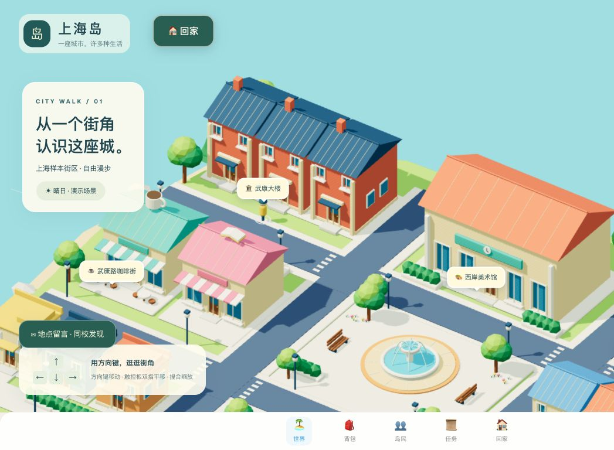
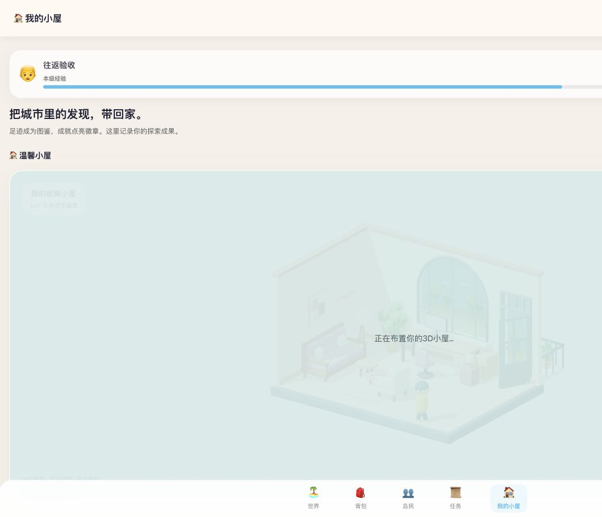

# 上海岛 · Shanghai Island

**把城市探索变成一场轻量游戏，把街角的发现带回自己的小屋。**

[开始在线体验 →](https://yangdanni726.github.io/shanghai-island/) · [直接进入小屋](https://yangdanni726.github.io/shanghai-island/island/) · [验收记录](docs/RELEASE_CHECK.md)

建议使用电脑横屏。首次进入创建岛民身份即可，无需注册账号或安装软件。



## 可以体验什么

- 五岛总览与一个可漫步的 3D 上海样本街区。
- 13 个探索地点，其中 4 个接入 3D 街道与演示交通方案。
- 探索、任务领奖、经验金币、徽章及地点图鉴。
- 地点留言、自选学校与同校内容筛选。
- 3D 小屋、蓝天绿树窗景、小人回家与固定路线停留。
- 城市与小屋往返时恢复会话内的角色位置、镜头和缩放。

## 三分钟体验

1. 创建岛民，观看或跳过五岛开场。
2. 方向键移动；双指滑动或拖动画布平移；加减按钮缩放，点击“回到角色”恢复跟随。
3. 点击地点列表或双击场景标记，选择交通方案并确认游戏内到达。
4. 在任务页领取奖励，看看地点留言和同校内容。
5. 点击城市顶部“🏠 回家”，在小屋查看成果，再用顶部“返回城市”继续探索。

触控板捏合也有实现；不同浏览器支持可能有差异，可使用缩放按钮替代。



## 项目定位与 AI 工作

面向本地青年，上海是样本城市。产品以游戏化探索降低了解城市的门槛，用地点话题连接轻社交，再通过个人小屋保存探索成果。

AI 辅助参与需求整理、视觉参考转译、Blender 程序化建模、Three.js 场景接入、前端交互、规则测试和问题排查。项目展示的是从产品构想到可运行原型的实现过程；市场判断仍是待验证假设，没有虚构用户增长或调研结果。

技术：Next.js、React、TypeScript、Three.js、Blender 生成的 GLB。部署：GitHub Actions 自动检查、构建并发布 GitHub Pages。

## 演示边界

交通时间和费用是示例，不是实时导航；游戏到达不等于现实到访。社交示例人物为虚构，新增留言、学校选择和玩家存档仅保存在当前浏览器，不会共享给其他访客。学校为自选，未认证。在线版与本地版存档分开。

小屋家具为固定样板，未开放自由装修。没有真实账号、云同步或多人在线。当前优先电脑横屏；原生捏合、独立浏览器兼容性及长期GPU压力尚未完整验收。

## 本地开发与验证

使用 Node.js 24：

```sh
npm ci
npm run dev -- --hostname 127.0.0.1 --port 4180
```

打开 http://127.0.0.1:4180/shanghai-island/ 。

```sh
npm run lint
npm test
npm run build
```

构建输出为 `out/`，固定路径 `/shanghai-island/`。可双击 `启动上海岛.command` 或运行 `python3 scripts/preview.py` 使用本地静态预览；需要 Python 3。已有服务会复用，端口冲突会提示，不会自动停止其他程序。

## 发布与文档

推送 `main` 后自动检查与发布；GitHub 仓库 Settings → Pages 的 Source 应为 GitHub Actions。发布失败时旧线上版本继续保留，检查 Actions 日志后修复。

[当前规则](docs/CURRENT_RULES.md) · [回家流程](docs/HOME_FLOW.md) · [验收范围](docs/RELEASE_CHECK.md)
